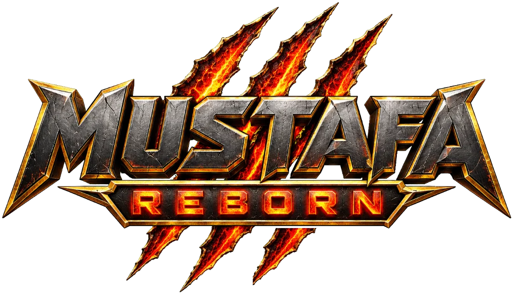

# MUSTAFA REBORN



A tribute to the 2002 arcade craze: a side-scrolling beat 'em up with dinosaurs, a car chase stage,
six bosses, and **online duels, free-for-alls and team-vs-team battles**.

> Fan-made tribute. All art is original (AI-painted for this project), not ripped from any commercial game.
> Not affiliated with Capcom.

## Play

| Action | Keys |
| --- | --- |
| Move | Arrow keys or W A S D |
| Attack / pick up | J or Z (tap for a 3-hit combo) |
| Jump | K, X or Space (attack in the air to jump-kick) |
| Special | L or C (hits all around, costs a little health) |
| Rising attack | Down, Up, Attack |
| Run | Double-tap left or right |
| Pause / leave match | P or Esc |

**On a phone or tablet:** open the link in the browser. A thumb-stick appears on the left (push it all the way to run) with ATTACK, JUMP and SPECIAL on the right; tap the menus. Play sideways for the biggest view, use ⛶ for full screen on Android, or "Add to Home Screen" on iPhone to launch it full screen like an app.

**Difficulty:** title menu → LEVEL cycles NORMAL / HARD (default) / LEGEND. Villains surround you, sidestep punches, punish whiffed combos and break out of long combos with a COUNTER.

**Campaign — Operation Reborn:** a sci-fi adventure in 5 chapters and 14 missions. Mustafa and Team Reborn (ROBIN the mechanic, NOVA the storm, ROY the bulldozer) chase Dr. Kaiser, who wants the Chrono-Fang time crystal, cyber-dinosaurs and an army from 65 million years ago. Missions: clear the area, smash jammers / serum tanks / power cores / rift pylons, free caged dinosaurs, rescue villagers, survive ambushes, defend the Cadillac, beat the clock, the Hell Road chase, a rescue mission for a kidnapped teammate, and boss hunts. Elite and cyber enemies (Cyber Raptor, Fang Trooper with lasers). Progress is saved; MISSIONS replays any unlocked mission.

**ROBOPLAY:** robot players for online battles. Press PLAY VS ROBOPLAY (duel, free-for-all or team) any time, even offline; if nobody joins a quick match within 12 seconds, ROBOPLAY joins automatically.

**Live worlds and music:** parallax backgrounds with moving clouds, water, waterfalls, searchlights and smoke; rain, storms with lightning, fog, embers and fireflies; night / dusk / alarm lighting. Each mission has its own adaptive score that builds up as the fight gets intense, muffles with a heartbeat at low health, and hits big stingers for bosses, objectives and the K.O.

**Online (title menu → ONLINE):**
- Pick a name and fighter, join a channel (Global, Bangladesh, Asia, …) or create your own.
- See who is online, chat, send friend requests, and challenge anyone to a duel.
- Create a team (up to 8 members), invite friends, and challenge another team to a team war.
- Create rooms: Duel 1v1, Free-for-all (up to 4), Team vs Team (up to 4v4).

## Run locally

```bash
npm install
npm start
```

Open http://localhost:8137. The same server hosts the game and the online lobby (WebSocket at `/ws`).
Open the game in two different browsers (or `localhost` and `127.0.0.1`) to test online play.

## Deploy

**Game + online server (recommended):** deploy this repo as a Node web service. On Render, use the
included `render.yaml` (New → Blueprint → pick this repo). Any Node host works: `npm install && npm start`,
`PORT` is read from the environment.

**GitHub Pages (static game only):** Pages can host the game but not the online server. After deploying the
server, put its URL in `config.js`:

```js
window.MUSTAFA_SERVER = 'https://your-server.onrender.com';
```

Friends and teams are saved to `server/data/db.json` (set `DATA_DIR` to a persistent disk in production).

## Project layout

- `index.html`, `config.js` — page, Royal Pass dialog, online hub
- `js/` — engine (input, audio), music (orchestral score), game, arena (online netcode), net (lobby UI), art & sprites
- `assets/sprites` — sliced sprite atlases; `assets/bg` — stage paintings and cover
- `server/server.js` — static server + lobby, friends, teams, rooms, match relay
- `tools/slice.js` — turns painted sheets on magenta into atlases; `tools/test-server.js` — 4-player server smoke test

## Royal Pass

The subscription checkout is a **demo** (no payment is taken). Connect a real provider in `startCheckout()` in `js/royal.js`
and grant premium only after your server confirms the payment.
